# Awesome VPN, Privacy & Network Security 🛡️⚡

  

  
  
  
  
  

---

## 🌐 Overview & Ecosystem

A curated index of top **SaaS privacy platforms** and **open-source GitHub repositories** for **VPNs, Censorship-Resistant Proxies, Zero-Trust Mesh Overlays, Encrypted DNS Gateways, and Network Privacy Infrastructure**. 

Whether you are configuring sovereign enterprise zero-trust tunnels, deploying home network ad/malware DNS firewalls, bypassing state-level Deep Packet Inspection (DPI), or linking multi-cloud environments via WireGuard meshes, this guide provides complete market intelligence, transparent pricing, and community metrics.

🌟 **Star this repository** if you find it valuable for your network architecture and privacy setups!

---

## 📑 Table of Contents
- [📊 Sector Overview & Market Dynamics](#-sector-overview--market-dynamics)
- [☁️ SaaS & Hosted Platforms](#️-saas--hosted-platforms)
- [💻 Open-Source GitHub Projects](#-open-source-github-projects)
- [📈 Star History](#-star-history)
- [🤝 Support & Sponsorship](#-support--sponsorship)
- [📝 How to Contribute](#-how-to-contribute)
- [⚖️ Disclaimer](#️-disclaimer)

---

## 📊 Sector Overview & Market Dynamics

The global Virtual Private Network (VPN) and zero-trust remote access market is valued at approximately **$60B to $78B in 2026** and is projected to surpass **$150B–$200B by the early 2030s**, expanding at a Compound Annual Growth Rate (CAGR) of **14% to 17%**. 

The sector exhibits **moderate fragmentation with dual-tier competitive dynamics**: the consumer privacy VPN market is moderately fragmented across hundreds of commercial brands (with significant portfolio roll-ups led by conglomerates like Kape Technologies and Nord Security), while enterprise remote access is transitioning toward a more consolidated Zero-Trust Network Access (ZTNA) / Secure Access Service Edge (SASE) model where hyperscalers (Cloudflare) and specialized mesh networks (Tailscale) compete directly with legacy perimeter VPN appliances.

---

## ☁️ SaaS & Hosted Platforms

The following SaaS and hosted privacy/VPN platforms are sorted in descending order by **Company Size (Market Capitalization, Private Valuation, or Parent Annual Revenue)**.

| SaaS Platform 🚀 | Description 📖 | Company Size (Valuation / Revenue) 🏢 | Starting Tier Pricing 💳 | Free Tier / Trial Limit 🎁 |
| :--- | :--- | :--- | :--- | :--- |
| **[Cloudflare WARP](https://one.one)** | Encrypted consumer & Zero Trust edge tunnel powered by BoringTun WireGuard and MASQUE protocols. | **$38B+ Market Cap** (NYSE: NET, ~$1.3B+ ARR) | $4.99 / month (WARP+ Argo routing) | **Free forever plan**: Unlimited data & bandwidth on standard global network |
| **[NordVPN](https://nordvpn.com)** | High-speed privacy VPN powered by NordLynx (WireGuard), Threat Protection DNS filtering, and Meshnet linking. | **$3.0B Valuation** (Nord Security, ~$350M+ ARR) | $3.09 / month (billed $83.43 for 2 years) | **30-day money-back guarantee** (Full feature access, risk-free refund window) |
| **[ExpressVPN](https://expressvpn.com)** | High-speed global VPN featuring Lightway protocol, TrustedServer RAM infrastructure, and split tunneling. | **$1.5B+ Parent Valuation** (Kape Technologies, $623M ARR) | $6.67 / month (billed $99.95 for 15 months) | **30-day money-back guarantee** (or 7-day free trial on iOS & Android app stores) |
| **[CyberGhost VPN](https://cyberghostvpn.com)** | Consumer privacy VPN offering dedicated streaming/P2P servers, WireGuard/OpenVPN, and NoSpy servers. | **$1.5B+ Parent Valuation** (Kape Technologies, $623M ARR) | $2.03 / month (billed $56.94 for 2 years + 4 mos) | **24-hour free trial on desktop** (no card needed), 3-7 day mobile trial, or 45-day money-back guarantee |
| **[Private Internet Access (PIA)](https://privateinternetaccess.com)** | Open-source desktop/mobile VPN clients, WireGuard/OpenVPN, MACE DNS ad-blocking, and port forwarding. | **$1.5B+ Parent Valuation** (Kape Technologies, $623M ARR) | $2.03 / month (billed $79.00 for 3 years + 3 mos) | **30-day money-back guarantee** (or 7-day free trial on iOS & Android apps) |
| **[Tailscale](https://tailscale.com)** | Zero-config WireGuard mesh VPN connecting devices, servers, and home labs with automatic NAT traversal and MagicDNS. | **$1.0B Valuation** (Series B Unicorn) | $6.00 / user / month (billed annually) or $8 / mo | **Free forever Personal tier**: Up to 3 users, 100 devices, and 3 ACL groups |
| **[Surfshark](https://surfshark.com)** | Cloud VPN with unlimited simultaneous device connections, WireGuard, CleanWeb ad-blocking, and MultiHop. | **~$600M+ Est. Valuation** (Merged under Cybex / Nord Security) | $1.99 / month (billed $53.73 for 2 years + 3 mos) | **30-day money-back guarantee** (or 7-day free trial on iOS, macOS & Android) |
| **[Proton VPN](https://protonvpn.com)** | Audited open-source VPN clients, WireGuard acceleration, Secure Core routing, Stealth protocol, and NetShield. | **~$500M+ Est. Valuation** (Proton AG, Swiss foundation-backed) | €4.49 / month (~$4.85/mo billed €107.76 for 2 years) | **Free forever tier**: 1 device, medium speed, 3 server countries (US, NL, JP), zero data caps |
| **[IPVanish](https://ipvanish.com)** | Tier-1 owned server backbone with WireGuard tunneling, SOCKS5 proxy support, and unmetered device connections. | **~$250M+ Est. Valuation** (Ziff Davis / J2 Global division) | $2.19 / month (billed $52.56 for 2 years) | **30-day money-back guarantee** (or 7-day free trial on iOS & Android apps) |
| **[Mullvad VPN](https://mullvad.net)** | Anonymity-focused VPN requiring zero personal info (anonymous account numbers, cash/crypto) with DAITA defenses. | **~$35M+ Est. Revenue** (Amagicom AB, self-funded/bootstrapped) | €5.00 / month flat rate (~$5.40 / month) | **No free tier** (Fixed €5/month pricing model, 30-day money-back guarantee for refundable payments) |
| **[Windscribe](https://windscribe.com)** | Cloud VPN and firewall with custom WireGuard/OpenVPN generators, R.O.B.E.R.T. DNS filter, and stealth transport. | **~$20M+ Est. Revenue** (Windscribe Limited, self-funded) | $5.75 / month (billed $69/year) or $3/mo build-a-plan | **Free forever tier**: 10 GB bandwidth per month (with confirmed email) across 10+ server locations |
| **[IVPN](https://ivpn.net)** | Independently audited, anti-tracking VPN with open-source clients, WireGuard key rotation, and AntiTracker DNS. | **~$10M+ Est. Revenue** (Privatus Limited, self-funded) | $6.00 / month (IVPN Standard) | **No free tier** (30-day money-back guarantee on all subscription plans) |

---

## 💻 Open-Source GitHub Projects

The following repositories are sorted in descending order by **GitHub Stars_Count**. Every Stars_Badge links directly to the stargazer community of that specific project.

| Open-Source Project 🛠️ | GitHub_Stars ⭐ | Description 📝 | Primary Protocols & Capabilities 🔒 |
| :--- | :--- | :--- | :--- |
| **[Pi-hole](https://github.com/pi-hole/pi-hole)** |  | Network-wide ad, tracker, and malware blocking DNS sinkhole for local home labs and VPN gateways. | DNS-level Sinkholing, FTLDNS, DHCP Server, Regex Whitelisting/Blacklisting |
| **[Headscale](https://github.com/juanfont/headscale)** |  | Open-source, self-hosted implementation of the Tailscale coordination control server. | WireGuard, DERP Relay, MagicDNS, Multi-User Tailnet Sovereignty, OIDC Integration |
| **[Xray-core](https://github.com/XTLS/Xray-core)** |  | Next-generation proxy and encrypted tunneling core engineered to defeat deep packet inspection. | VLESS, XTLS-Reality, Vision, Trojan, Shadowsocks, Camouflage TLS 1.3 Routing |
| **[sing-box](https://github.com/SagerNet/sing-box)** |  | Universal proxy and VPN platform in Go featuring high-performance multiplexed network routing. | WireGuard, VLESS-Reality, Hysteria 2, TUIC, Shadowsocks, System TUN Engine |
| **[Tailscale](https://github.com/tailscale/tailscale)** |  | The open-source client daemon, command line interface, and core libraries for Tailscale mesh networks. | WireGuard Mesh, Disco NAT Traversal, MagicDNS, Subnet Routers, Exit Nodes |
| **[AdGuard Home](https://github.com/AdguardTeam/AdGuardHome)** |  | Network-wide privacy protection software operating as a local DNS server redirecting tracking domains. | DoH (DNS-over-HTTPS), DoT (DNS-over-TLS), DoQ (DNS-over-QUIC), Ad/Tracker Blocking |
| **[V2Ray Core](https://github.com/v2fly/v2ray-core)** |  | Censorship circumvention and anti-DPI network tool suite powering modular encrypted proxies. | VMess, VLESS, mKCP, WebSocket Obfuscation, Dynamic Routing, TLS Camouflage |
| **[NetBird](https://github.com/netbirdio/netbird)** |  | Zero-trust overlay networking platform combining WireGuard encryption with automated WebRTC NAT traversal. | WireGuard, WebRTC ICE/STUN/TURN, SSO/IdP Integration (Okta/Azure), Granular ACLs |
| **[Algo VPN](https://github.com/trailofbits/algo)** |  | Hardened Ansible automation scripts provisioning on-demand secure WireGuard and IPsec VPN servers. | WireGuard, IPsec (IKEv2), Automated Cloud Deployment (AWS, DigitalOcean, GCP), DNS Adblocking |
| **[wg-easy](https://github.com/wg-easy/wg-easy)** |  | Dockerized all-in-one WireGuard server paired with a responsive, modern web admin management UI. | WireGuard, Web UI, QR Code Auto-Generation, Client Traffic Monitoring, Docker-ready |
| **[Streisand](https://github.com/StreisandEffect/streisand)** |  | Automated setup scripts for deploying multi-protocol censorship-resistant VPN gateways across cloud providers. | WireGuard, OpenVPN, Shadowsocks, Tor Bridge, Stunnel, Automated TLS Provisioning |
| **[Hysteria 2](https://github.com/apernet/hysteria)** |  | High-throughput, anti-censorship proxy and VPN protocol powered by custom QUIC congestion control. | Modified QUIC Transport, Salamander Obfuscation, Port Hopping, Lossy Network Optimization |
| **[Nebula](https://github.com/slackhq/nebula)** |  | Mutually authenticated peer-to-peer overlay mesh network designed by Slack for multi-region connectivity. | Noise Protocol, Encrypted UDP Tunnels, Lighthouse Discovery, Certificate-based Firewalls |
| **[openvpn-install](https://github.com/angristan/openvpn-install)** |  | Hardened OpenVPN road warrior installer script for Ubuntu, Debian, CentOS, Fedora, and Arch Linux. | OpenVPN SSL/TLS, Custom Cipher Suites, Automated Client Cert Generation, NAT Routing |
| **[AmneziaVPN Client](https://github.com/amnezia-vpn/amnezia-client)** |  | Multi-protocol open-source desktop and mobile VPN client with one-click automated self-hosted server deployment. | AmneziaWG, WireGuard, OpenVPN over Cloak, Shadowsocks, Xray/VLESS-Reality |
| **[OpenVPN](https://github.com/OpenVPN/openvpn)** |  | The gold standard open-source SSL/TLS VPN daemon providing robust cross-platform network tunneling. | SSL/TLS, TCP/UDP Transport, TUN/TAP Virtual Interfaces, X.509 PKI Security |
| **[SoftEther VPN](https://github.com/SoftEtherVPN/SoftEtherVPN)** |  | Powerful multi-protocol VPN engine engineered by University of Tsukuba supporting enterprise bridging. | SoftEther SSL-VPN, OpenVPN, L2TP/IPsec, MS-SSTP, EtherIP, Built-in NAT Traversal |
| **[Netmaker](https://github.com/gravitl/netmaker)** |  | Fast automated virtual overlay network platform building high-speed mesh networks on top of WireGuard. | Kernel WireGuard, Auto-Meshing Engine, Kubernetes CNI Integration, Multi-Cloud Egress |
| **[wireguard-install](https://github.com/angristan/wireguard-install)** |  | Automated shell script to deploy and configure a production-ready WireGuard VPN server on Linux. | WireGuard, Curve25519, ChaCha20-Poly1305, Automated QR Code Generation, IPv4/IPv6 Dual Stack |
| **[shadowsocks-rust](https://github.com/shadowsocks/shadowsocks-rust)** |  | Fast, memory-safe Rust implementation of the Shadowsocks censorship-resistant encrypted SOCKS5 proxy. | Shadowsocks AEAD, Rust Async/Tokio, SIP003 Plugins, Multi-threaded Forwarding |
| **[Firezone](https://github.com/firezone/firezone)** |  | Zero-trust network access (ZTNA) platform written in Rust and Elixir for granular enterprise resource security. | WireGuard, Zero-Trust Access Policies, OIDC/SAML Providers, Multi-Factor Authentication |
| **[PiVPN](https://github.com/pivpn/pivpn)** |  | Streamlined, interactive CLI installer turning Raspberry Pi or Debian/Ubuntu systems into dedicated VPN appliances. | WireGuard, OpenVPN, Unattended Upgrades, Client Profile Generator, Pi-hole Pairing |
| **[BoringTun](https://github.com/cloudflare/boringtun)** |  | Userspace WireGuard protocol implementation in Rust developed by Cloudflare to power WARP at edge scale. | WireGuard, Rust Memory Safety, Userspace TUN Execution, Cloudflare WARP Core |
| **[wstunnel](https://github.com/erebe/wstunnel)** |  | Tunneling tool encapsulating arbitrary TCP/UDP or WireGuard traffic over WebSocket and HTTP/2 connections. | WebSocket, HTTP/2, TLS Camouflage, Reverse Tunneling, Strict Proxy Traversal |
| **[Outline Server](https://github.com/Jigsaw-Code/outline-server)** |  | Censorship-resistant VPN server developed by Jigsaw (Google) with multi-user access key management. | Shadowsocks, Docker Containerized Server, Electron Management App, REST API Keys |
| **[Tor](https://github.com/torproject/tor)** |  | The flagship onion routing anonymity network implementation defending against traffic analysis and mass surveillance. | Multi-hop Onion Routing, Hidden Services (.onion), Directory Authorities, Pluggable Transports |
| **[wireguard-go](https://github.com/WireGuard/wireguard-go)** |  | Official userspace Go implementation of the WireGuard protocol for macOS, Windows, Android, and iOS. | WireGuard, Go Userspace Tunneling, Cross-Platform Portability, Crypto Primitives |
| **[i2pd](https://github.com/PurpleI2P/i2pd)** |  | Full-featured, lightweight C++ client for the Invisible Internet Project (I2P) anonymous decentralized network. | Garlic Routing, ElGamal/AES Encryption, SAM Bridge, I2P Tunnels &amp; EepSites |
| **[strongSwan](https://github.com/strongswan/strongswan)** |  | Enterprise IPsec-based VPN suite implementing modern IKEv1 and IKEv2 key exchange protocols. | IPsec, IKEv2, RADIUS/EAP Authentication, Site-to-Site Gateways, Mobile Network Profiles |
| **[wireguard-linux](https://github.com/WireGuard/wireguard-linux)** |  | Kernel codebase and driver tree integrating WireGuard directly into the upstream Linux kernel. | In-Kernel WireGuard, ChaCha20-Poly1305, Curve25519, High-Speed Zero-Copy UDP |
| **[AmneziaWG Go](https://github.com/amnezia-vpn/amneziawg-go)** |  | Censorship-resistant fork of WireGuard implementing random junk packet injection and header shuffling. | AmneziaWG, Header Camouflage, Junk Packet Padding, Anti-DPI Handshake Obfuscation |
| **[WireGuard Portal (wg-portal)](https://github.com/h44z/wg-portal)** |  | Self-hosted web management interface for WireGuard configurations, user provisioning, and statistics. | WireGuard Management, LDAP/OIDC Support, Web UI, Peer Expiration, Docker |
| **[Rosenpass](https://github.com/rosenpass/rosenpass)** |  | Post-quantum-secure key exchange daemon injecting quantum-resistant symmetric keys into WireGuard. | Post-Quantum Cryptography (Classic McEliece), Continuous PSK Rotation, WireGuard Hardening |
| **[OpenConnect](https://github.com/openconnect/openconnect)** |  | SSL VPN client compatible with Cisco AnyConnect, Juniper Pulse, Palo Alto GlobalProtect, and Fortinet. | SSL VPN, Cisco AnyConnect Emulation, DTLS Transport, Multi-Vendor Gateway Compatibility |

---

## 📈 Star History

---

## 🤝 Support & Sponsorship

Thank you for exploring and utilizing the **Awesome VPN, Privacy & Network Security** directory! 

Maintaining curated benchmarks, testing anti-censorship protocols, verifying pricing structures, and tracking open-source releases requires continuous effort. If this project helps you secure your network, protect your digital footprint, or benchmark infrastructure tools, please consider supporting its ongoing development:

- ⭐ **Star this repository** on GitHub to amplify its reach.
- 🍴 **Fork and share** with privacy enthusiasts, network admins, and DevOps teams.
- ☕ **Buy a coffee & sponsor ongoing research** via the [GitHub Sponsor Dashboard](https://github.com/sponsors/ishandutta2007).

Your support keeps this ecosystem independent, up-to-date, and community-driven!

---

## 📝 How to Contribute

Contributions are warmly welcomed! To suggest a new open-source repository or update a SaaS platform:
1. Ensure the project is actively maintained and relevant to VPNs, anti-DPI censorship circumvention, zero-trust mesh networking, or privacy DNS.
2. Maintain factual, objective descriptions without marketing hyperbole.
3. Submit a pull request with appropriate links and clean markdown formatting.

---

## ⚖️ Disclaimer

*All product names, logos, brands, and trademarks referenced herein belong to their respective owners. Inclusion in this list does not constitute an endorsement. Verify compliance with local network regulations and service terms before deploying any tunneling or obfuscation tools.*
